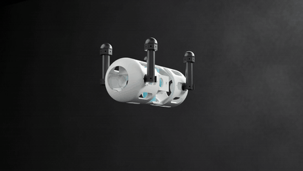
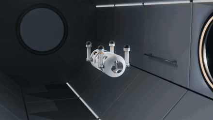

<div align="center">
<h1>Felis: A Cat-Inspired Robot with an Actuated Spine</h1>

<a href="https://frank-zy-dou.github.io/blog/felis/"></a>

<a href="https://frank-zy-dou.github.io/">Zhiyang Dou</a><sup>&#42;&dagger;</sup>,
<a href="https://scholar.google.com/citations?user=fpo7qVYAAAAJ&hl=en">Pengfei Ye</a><sup>&#42;</sup>,
<a href="https://yuxiang-ma.github.io/">Yuxiang Ma</a><sup>&#42;</sup>,
<a href="https://www.linkedin.com/in/kens01">Ken Suzuki</a><sup>&#42;</sup>,
<a href="https://zeshiyang.github.io/">Zeshi Yang</a><sup>&#42;</sup>,
<a href="https://yh2371.github.io/">Yiming Huang</a>,
<a href="https://livingsoul.weebly.com/">WeiHsi Chen</a>,
<a href="https://yujiewang.info/">Yujie Wang</a>,
<a href="https://www.minghaoguo.com/">Minghao Guo</a>,
<a href="https://engineering.tamu.edu/cse/profiles/Wang-Wenping.html">Wenping Wang</a>,
<a href="https://i.cs.hku.hk/~taku/">Taku Komura</a>,
<a href="https://people.csail.mit.edu/wojciech/">Wojciech Matusik</a>,
<a href="https://sung.seas.upenn.edu/people/sung/">Cynthia Sung</a>,
<a href="https://lingjie0206.github.io/">Lingjie Liu</a>

<sup>&#42;</sup>Co-first authors&emsp;<sup>&dagger;</sup>Project lead
</div>

<p align="center">
  <a href="assets/teaser.mp4"></a>
  <a href="assets/microgravity.mp4"></a>
</p>
<p align="center"><sub>Left: mid-air righting, landing and walking. Right: righting in microgravity. Click for the full videos.</sub></p>

Felis is a small quadruped with a two-axis spine (waist yaw and pitch) and one motor per hip. Like a cat, it rights itself in mid-air by
twisting and bending its spine; the same six motors also make it walk and jump.

This folder contains the inference code and trained policies for three skills. Training code, simulation assets and 3D models are not
included.

| Skill | Policy | Network (ELU MLP) | Parameters |
|---|---|---|---|
| Walking | [`policies/walking`](policies/walking) | 29 → 128 → 64 → 6 | 12,486 |
| Mid-air righting | [`policies/righting`](policies/righting) | 28 → 128 → 64 → 6 | 12,358 |
| Jump | [`policies/jump`](policies/jump) | 29 → 64 → 32 → 6 | 4,198 |

Each policy folder holds `actor.pt` (state dict), `actor_jit.pt` (TorchScript) and `policy_meta.json` (observation layout and scales,
PD gains, joint limits, commands).

## Quick start

```bash
git clone --filter=blob:none --sparse https://github.com/Frank-ZY-Dou/Computational-Design-Fabrication.git
cd Computational-Design-Fabrication && git sparse-checkout set Felis && cd Felis
pip install -r requirements.txt

python felis_policy.py --selftest     # frame conventions and timing
python examples/run_policy.py         # one walking step on synthetic readings
python examples/check_parity.py       # replay the reference data in parity/
```

```python
from felis_policy import FelisPolicy

pol = FelisPolicy("policies/walking/actor.pt")
pol.reset()
pol.set_command(0.2, 0.0, 0.0)        # vx (m/s), vy (m/s), wz (rad/s)
target, raw = pol.compute_action(base_quat, base_ang_vel, dof_pos, dof_vel)   # every 20 ms
```

## Interface

| | |
|---|---|
| Joints | `waist_yaw, waist_pitch, hip_FR, hip_FL, hip_RL, hip_RR`; output-shaft angles (rad), zero with the legs straight down |
| Attitude | unit quaternion `[w, x, y, z]`; IMU on the middle body segment (`compute_observation_imu`), or the rear body's attitude from a simulator (`compute_observation`) |
| Gyro | body-frame rate, rad/s |
| Output | joint position targets for a PD loop on each shaft; gains in `policy_meta.json` |
| Rate | 50 Hz, no skipped steps; `reset()` restarts the action history and clock |

## Commands

| Skill | Usage |
|---|---|
| Walking | `set_command(vx, 0, wz)` with `vx` in [-0.3, 0.35] m/s and `wz` in [-0.8, 0.8] rad/s; turn only while moving. No sideways stepping or turning in place. |
| Righting | Release belly-up. At release call `reset()` and `set_drop_height(h)`, where `h` is the waist height above the landing surface (2.5-3.5 m). Do not run while held. |
| Jump | `reset()`, stand with a zero command for ~1 s, then `set_command(0.6, 0.5, 0)` for 1 s and back to zero. |

## Parity data

`parity/<skill>.npz` records, per control step, the sensor readings, command, observation, action and target of a reference rollout.
`examples/check_parity.py` replays them; a port to another runtime should match the targets within 1e-4 rad.
